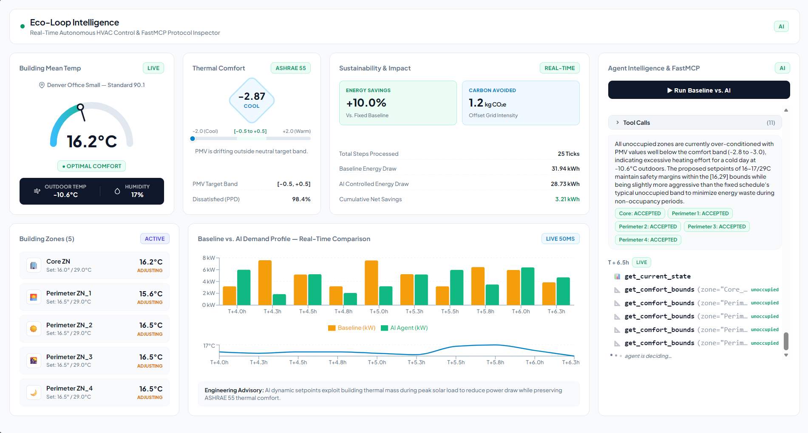

# Eco-Loop

Closed-loop LLM-supervised EnergyPlus building energy control. The system runs a live
EnergyPlus co-simulation, dispatches an LLM (via Ollama) on a ReAct loop to make
setpoint decisions every simulated 15-minute interval, compares AI-driven savings
against a deterministic rule-controller baseline, and streams everything to a React
dashboard.




See [ARCHITECTURE.md](ARCHITECTURE.md) for the full tool-calling design, prompt
engineering strategy, latency management, and known limitations.

## Features

- **ReAct orchestration** — Observe → Reason → Act → Validate, with a comfort
  safety net that corrects unsafe zone states after every turn.
- **Tool-mediated writes** — every actuator change passes through `ToolLayer`,
  which clamps setpoints to safe ranges, enforces a 2°C/interval rate limit,
  and rejects proposals that collapse the heating/cooling deadband.
- **Two-pass benchmark** — a standalone baseline run (rule controller, no LLM)
  runs concurrently alongside the AI-driven pass so the dashboard compares
  kWh/temp/PMV against a real reference profile, not a self-reference.
- **MCP server** — the same four tools the LLM uses are exposed over the Model
  Context Protocol (`/mcp`), backed by the live `ToolLayer` instance, not a
  separate demo copy.
- **Kill switch** — revert the live building to the fixed baseline schedule at
  any time; resume AI control when ready.
- **HTTP long-poll state updates** — no WebSocket, no fixed-interval polling;
  the client calls `GET /state/updates?since=<version>` and blocks until a new
  tick lands (25 s timeout).
- **SQLite event log** — every tick, tool call (accepted/rejected), rationale,
  and MCP trace is persisted and queryable for post-hoc analysis.

## Prerequisites

| Tool | Version | Notes |
|---|---|---|
| [EnergyPlus](https://energyplus.net/downloads) | 24.x+ | Add its install dir (containing `pyenergyplus/`) to `PYTHONPATH` |
| [Ollama](https://ollama.com) | — | `ollama serve` must be running |
| Python | 3.12+ | |
| Node.js | 18+ | For the React dashboard |

## Setup

```bash
# 1. Python dependencies
pip install -r requirements.txt

# 2. Pull the LLM (self-hosted, default: qwen3.5:4b)
ollama pull qwen3.5:4b

# 3. Verify the environment
python scripts/check_env.py
```

Override the model with `OLLAMA_MODEL=<name>` in `.env`.
`qwen3.5:4b` was chosen for reliable native function-calling that fits in
4 GB VRAM; `phi4-mini` was found flaky with Ollama's template parser for
tool calls.

## Running the system

### Backend

```bash
python -m uvicorn api.app:app --port 8000
```

This starts the FastAPI backend and the control-loop consumer thread only — the
EnergyPlus simulation stays idle until the benchmark run is started (EnergyPlus
can only be run once per process).

### Frontend

In a second terminal:

```bash
cd dashboard
npm install
npm run dev
```

Open the printed dashboard URL and click **▶ Run Baseline vs. AI**.

Once a run is active, a **kill switch** appears next to the benchmark button
(`POST /control/revert-to-baseline`) — it reverts the live building to the
fixed baseline schedule. **Resume AI Control** (`POST /control/resume-ai`) hands
it back to the LLM.

## Eco-MCP server

A real MCP server (`agent/mcp_server.py`, named `eco-mcp`, built with the
official `mcp` SDK's `FastMCP`) exposes four tools at `/mcp`:

| Tool | Effect |
|---|---|
| `get_current_state` | Zone temps, RH, PMV/PPD, outdoor conditions, facility kW (read-only) |
| `get_comfort_bounds` | Live occupancy + ASHRAE 55 comfort band for a zone (read-only) |
| `get_recent_history` | Last N accepted/rejected decisions (read-only) |
| `propose_setpoint_change` | Write path — clamped, rate-limited, safety-checked |

These are the same tools backed by the same live `ToolLayer` as the direct
dispatch path — mounted at `/mcp` in the running FastAPI app. Any MCP client
(Claude Desktop, the `mcp` CLI, or the repo's own `agent/mcp_orchestrator.py`)
can drive the live sim through it.

Two dispatch paths, same `ToolLayer` instance:

- **Direct** (`TOOL_TRANSPORT=direct`): plain Python method calls in-process.
- **MCP** (`TOOL_TRANSPORT=mcp`, default): `mcp.client.streamable_http` →
  `ClientSession.call_tool()` against the `/mcp` endpoint.

Verify the server independently:

```bash
python scripts/smoke_test_mcp.py
```

This spins up its own uvicorn instance and performs a wire-level round-trip
without needing a live simulation.

## How it works

### Per control interval (15 simulated minutes)

1. `SimulationRunner` publishes a `StateSnapshot` (zone temps, RH, outdoor
   conditions, facility electricity) onto a thread-safe queue.
2. `ControlLoopService._control_loop` picks it up, looks up the matching
   baseline reference point (nearest-neighbor by sim time), and invokes the
   orchestrator.
3. The orchestrator runs a ReAct loop:
   - **Observe** — call `get_current_state` and `get_comfort_bounds`.
   - **Reason** — the LLM produces a rationale and proposes a setpoint change.
   - **Act** — `propose_setpoint_change` is sent through `ToolLayer`, which
     clamps the values, checks the deadband, and applies a 2°C/interval rate
     limit.
   - **Validate** — rejected proposals are logged; accepted ones update the
     live setpoints.
4. After the LLM step, the **comfort safety net** checks every zone — if any
   zone is occupied and out-of-band (or has an invalid setpoint pair that the
   LLM never corrected), it proposes a corrective change through the same
   validated path, logged as `source: comfort_safety_net`.
5. Every tool call (LLM-issued or safety-net) is published to the dashboard
   instantly via the long-poll channel so the reasoning feed streams live.
6. The tick (baseline + AI telemetry, rationale, actions, full MCP trace) is
   persisted to SQLite.
7. `SimulationRunner.decision_applied()` releases EnergyPlus to the next
   interval.

### Latency design

- The sim thread **never blocks** on the LLM — a slow response means the
  previous safe setpoint holds longer, not a stall.
- The baseline/AI comparison pass uses **lockstep mode** — EnergyPlus blocks
  after each control interval until `decision_applied()` is called, ensuring
  correct interval-for-interval alignment for comparison.
- Tick cadence is **real-time**, not artificially paced.
- Dashboard updates use **HTTP long-polling** (`GET /state/updates?since=<version>`),
  not WebSocket or fixed-interval polling.

## Dashboard


The React dashboard (Vite + Recharts) displays:

- **MainTemperatureGauge** — overall building temperature at a glance.
- **ZoneListWidget** — per-zone current state, setpoints, and comfort status.
- **ComfortDiamondCard** — PMV/PPD visualization per zone.
- **TelemetryChart** — temperature, PMV, and electricity trends over the
  simulation run.
- **SustainabilityImpact** — estimated energy savings vs. baseline.
- **AgentMCPInspector** — live-streamed tool calls, rationales, actions, and
  the MCP tool call trace in real time.
- **KillSwitch** — toggle between baseline and AI control mid-run.

## Testing

```bash
# Unit tests
pytest agent/tests/ -q

# MCP server smoke test (no live sim needed)
python scripts/smoke_test_mcp.py
```

The `api/tests/` directory is reserved for integration tests that require a
running backend.

## Project layout

```
eco-loop/
├── .env
├── .gitignore
├── ARCHITECTURE.md
├── README.md
├── requirements.txt
├── agent/
│   ├── tools.py
│   ├── orchestrator.py
│   ├── llm_client.py
│   ├── schemas.py
│   ├── pmv.py
│   ├── rule_controller.py
│   ├── rate_limiter.py
│   ├── mcp_server.py
│   ├── mcp_orchestrator.py
│   └── tests/
├── api/
│   ├── app.py
│   ├── control_service.py
│   ├── db.py
│   └── tests/
├── simulation/
│   └── runner.py
├── dashboard/
│   ├── src/
│   │   ├── App.jsx
│   │   ├── api.js
│   │   ├── index.css
│   │   └── components/
│   ├── vite.config.js
│   └── package.json
├── models/
│   ├── ASHRAE901_OfficeSmall_STD2019_Denver.idf
│   ├── USA_IL_Chicago-OHare.Intl.AP.725300_TMY3.epw
│   ├── out/
│   └── out_baseline/
├── data/
└── scripts/
    ├── check_env.py
    └── smoke_test_mcp.py
```